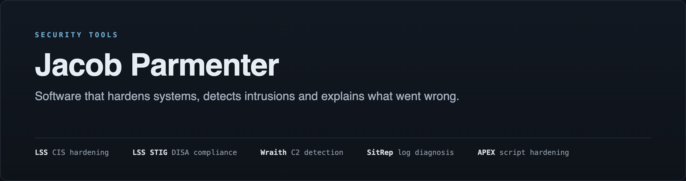
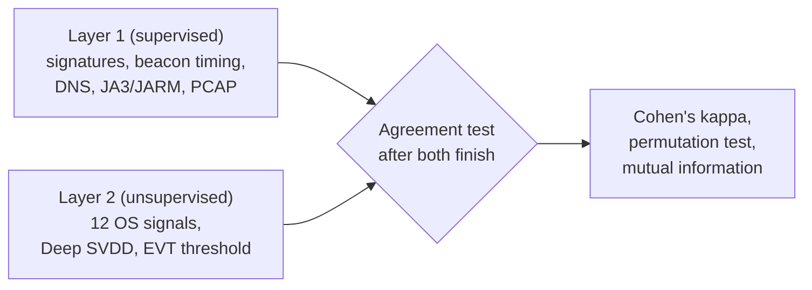

Five security tools and three AI web apps I designed and built. The source is private, so this page shows what each one does. Every terminal image is output from a real run, trimmed to fit. Each web app section says what its image shows.

| Project | What it does | Built with | Status |
|---|---|---|---|
| [**LSS**](#lss-linux-security-suite) | Audits and hardens Linux against the CIS Benchmark, with rollback | Python | v1.0.2 |
| [**LSS STIG**](#lss-stig) | Audits and hardens Ubuntu against DISA STIGs and writes STIG Viewer checklists | Python | v1.0.0 |
| [**Wraith**](#wraith) | Detects command-and-control activity from how it disturbs the operating system | Python, NumPy, eBPF | v2.6.0, in active development |
| [**SitRep**](#sitrep) | Reads system logs and explains in plain English what went wrong | Rust | v0.2.1 |
| [**APEX**](#apex) | Raises shell scripts to the standard their job calls for, offline | Python | Working |
| [**Canon**](#canon) | Checks a whole novel for continuity errors in one pass | Next.js, TypeScript, Claude API | Sample demo tested, live Claude pass not yet run |
| [**Cull**](#cull) | Groups photo bursts and keeps the best shot from each | Next.js, TypeScript, Claude API | Local culling tested, Claude picks not yet run |
| [**ReplyDesk**](#replydesk) | Drafts replies to customer reviews and messages in a business's own voice | Next.js, TypeScript, Claude API | Interface prototype |

---

## LSS (Linux Security Suite)

**Audit a Linux host against the CIS Benchmark, fix what can safely be automated, and undo it if something breaks.**

A single command-line tool with no agent and no cloud service. It covers 206 controls across 11 sections and can fix 166 of them automatically.

The other 40 stay audit-only on purpose. Repartitioning, bootloader edits and account decisions can take a machine down or destroy evidence, so LSS gives the operator the exact steps instead of guessing.

Here's a stock Ubuntu 24.04 machine before hardening, and after hardening and a reboot:

<table>
<tr>
<td width="50%"></td>
<td width="50%"></td>
</tr>
</table>

Failing controls dropped from 72 to 4, and the result held after the reboot.

**Built to be safe on a live system**

- **Rollback journal:** every change is recorded with a backup of the file and its undo command. Rollback replays them in reverse and reports anything it couldn't undo. In the run above it finished with no errors, even after the reboot, and `sshd_config`, `sysctl.conf`, `fstab` and `login.defs` came back byte-identical. One kernel setting that can't be changed back while running returns to normal at the next boot, and LSS says so.
- **Lockout protection:** LSS checks before making changes that could cut you off. Here it refused to disable root SSH login because the machine had no other admin account:

- **No shell commands:** undo steps never run through a shell, and a regression test enforces that.
- **Honest results:** a check that can't read its evidence reports that, instead of passing.

---

## LSS STIG

**The DISA STIG edition: audit, harden and roll back, with a checklist ready for STIG Viewer 3.**

It covers all 194 rules of the Canonical Ubuntu 24.04 LTS STIG, V1R6, with no third-party dependencies, so it works on air-gapped machines. Every audit writes a `.cklb` checklist with the evidence for each automated check.

Here's a stock Ubuntu 24.04 machine before hardening, and after hardening and a reboot:

<table>
<tr>
<td width="50%"></td>
<td width="50%"></td>
</tr>
</table>

One run applied 102 fixes with no errors and took open findings from 123 to 18. Those 18 need an operator's decision. After rollback, audit results, packages, services, firewall state and SSH settings all matched the original machine.

**It doesn't blindly apply DISA's fix text.** Some published fixes would damage the machine, so LSS STIG does what the rule's check actually verifies:

| Rule | DISA's fix text | What could go wrong | What LSS STIG does |
|---|---|---|---|
| V-270824 | `chmod -R 755` on command directories | Strips setuid from `sudo`, `su` and `passwd` | Removes only the directory's write bits |
| V-270655 | `ufw enable` | Locks out a remote admin | Sets `ufw limit` on SSH ports first |
| V-270645 | Purge `systemd-timesyncd` | Leaves the machine with no time daemon | Installs chrony first |
| V-270694 | Loop around the consent prompt | Hangs any login shell with no terminal at 100% CPU | Refuses that session |

---

## Wraith

**Detects command-and-control (C2) activity from how it disturbs the operating system, not from what its traffic looks like.**

An implant can encrypt its traffic and disguise its domains, but it can't run without creating threads, allocating memory and opening sockets. Wraith learns what normal looks like across 12 OS signals and flags activity that falls outside it.

Wraith is the reference implementation of my paper: [*The Wraith: Manifold-Based Command-and-Control Detection Through Involuntary Operating System Telemetry with Blind Dual-Layer Validation*](https://doi.org/10.5281/zenodo.19561081).

The two layers share no data, so their agreement is a real test of whether the unsupervised detector works. It also flagged a C2 framework that Layer 1 was never told about:

An event-driven eBPF fast path catches short bursts of hands-on-keyboard activity that one-second sampling averages away:

> **Where it stands:** both results above come from synthetic workloads, so they aren't field detection rates. Validation against real captures and live implants is the next stage of the project.

---

## SitRep

**Tells you what went wrong with a machine, why it matters and what to type next.**

SitRep reads the system logs on Linux or macOS, matches them against about 50 built-in failure patterns, and prints a ranked report. This run used a sample log with disk and memory failures:

- **Fully offline:** no network code at all, and CI fails the build if any is added.
- **One binary:** Linux builds are statically linked and macOS gets a universal binary.
- **Learns new patterns:** lines it doesn't recognize are grouped, and it drafts rules for them.
- **Works with automation:** JSON output and exit codes for cron and CI, plus piped logs from remote servers.

---

## APEX

**Works out what a script is for, then raises it to the standard for that kind of work.**

| If the script is for | APEX raises it to |
|---|---|
| CIS hardening | DISA STIG practices |
| Forensic acquisition | Chain of custody, dual hashing and verification, write-blocking |
| OS installation | Unattended or interactive installs with preflight checks and destroy guards |
| Anything else | Strict mode, error traps, logging, locking and proper command-line options |

The engine is deterministic and fully offline, with no third-party dependencies. It adds only what a script is missing, running it again changes nothing, and it checks the result before writing it. Here it upgrades a sample forensic script (trace shortened):

---

## Canon

**A continuity editor for novels: it builds a story bible, then checks the manuscript against it.**

Canon pulls out the book's characters, locations, timeline and world facts into a bible the author can edit. A second pass sends the whole manuscript and the bible to Claude in one call and reports each continuity break with a severity rating.

The report card in this image is an illustration from the home page, not output from a real book.

> **Where it stands:** uploading and parsing a manuscript works. The bundled 5-chapter sample ran through both steps and showed 6 findings, but its analysis is hand-written demo data. A live Claude pass hasn't been run in testing yet.

---

## Cull

**Groups near-duplicate photos, picks a keeper from each burst and exports the keepers as a zip.**

Perceptual hashing and sharpness scoring run in the browser. An optional step asks Claude to choose the best shot in each burst, sending 256px thumbnails rather than the full photos.

The burst in this image is a home page illustration. The "100% on-device" label is older wording: the Claude step does send thumbnails, and the app now says "Full photos stay on-device".

> **Where it stands:** in a test with 15 synthetic images, Cull sorted all 12 burst frames into the correct 3 bursts and exported 5 keepers as a zip. The automatic junk flags still need work: on those images it marked one sharp photo for deletion and missed a simulated screenshot. The Claude step hasn't been run in testing yet.

---

## ReplyDesk

**Drafts replies to customer reviews, emails and DMs in a business's own voice.**

The flow starts with a short interview to learn how the business sounds, then opens an inbox where each message gets a draft that can be adjusted for tone.

This image is promotional artwork, not a screenshot.

> **Where it stands:** this is an interface prototype. The app runs, but the interview is scripted and the inbox holds sample messages, with no way yet to bring in real reviews. Claude drafting is built for use with a customer's own API key, but it hasn't been run in testing yet.

---

## Testing

LSS and LSS STIG also went through full harden, reboot and rollback cycles on an Ubuntu 24.04 arm64 VM. Test suites as last run: LSS, LSS STIG, Wraith and APEX on Ubuntu 24.04 arm64, and SitRep, Canon and Cull on macOS. The Canon and Cull suites cover license validation, and ReplyDesk has no test suite yet.

| Tool | Result |
|---|---|
| LSS | 1,709 passed, 1 skipped |
| LSS STIG | 91 tests passed |
| Wraith | 675 passed, 4 skipped |
| SitRep | 79 passed |
| APEX | 101 checks passed |
| Canon | 10 passed |
| Cull | 10 passed |

---

## Contact

For a demo or licensing: **jakep8888@proton.me**

Copyright © 2026 Jacob Douglas Parmenter. All rights reserved. See [LICENSE](LICENSE).
