
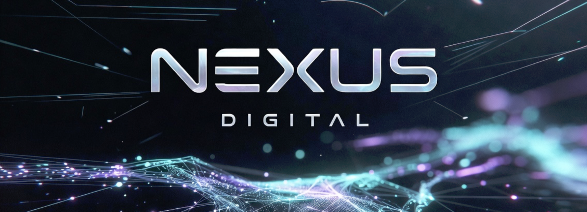

Nexus Digital is the independent studio of Jacob Parmenter. This page covers five security tools and three AI web apps I designed and built. Source code is private. Terminal images come from real runs, trimmed to fit.

| Project | Function | Stack | Status |
|---|---|---|---|
| [**LSS**](#lss-linux-security-suite) | CIS Benchmark audit, remediation and rollback for Linux | Python | v1.0.2 |
| [**LSS STIG**](#lss-stig) | DISA STIG audit, remediation and rollback for Ubuntu, with STIG Viewer checklists | Python | v1.0.0 |
| [**Wraith**](#wraith) | Manifold-based C2 detection from involuntary OS telemetry | Python, NumPy, eBPF | v2.6.0, in active development |
| [**SitRep**](#sitrep) | Offline system log diagnosis | Rust | v0.2.1 |
| [**APEX**](#apex) | Deterministic shell script hardening | Python | Working |
| [**Canon**](#canon) | Whole-manuscript continuity analysis | Next.js, TypeScript, Claude API | Beta, live Claude validation pending |
| [**Cull**](#cull) | Burst clustering and keeper selection for photos | Next.js, TypeScript, Claude API | Beta, live Claude validation pending |
| [**ReplyDesk**](#replydesk) | Voice-profile reply drafting for reviews, email and DMs | Next.js, TypeScript, Claude API | Prototype |

---

## LSS (Linux Security Suite)

**CIS Benchmark audit, remediation and journaled rollback from a single CLI, with no agent or cloud service.**

LSS implements 206 controls across 11 sections: 201 CIS-aligned controls and 5 LSS detection controls. `lss harden` can remediate 166 of them. The other 40 are audit-only by design and output the remediation command, because they cover partition layout, GRUB edits, AppArmor enforce mode, duplicate UIDs and unowned or SUID files that may be forensic evidence.

Stock Ubuntu 24.04 before hardening, and after hardening and a reboot:

<table>
<tr>
<td width="50%">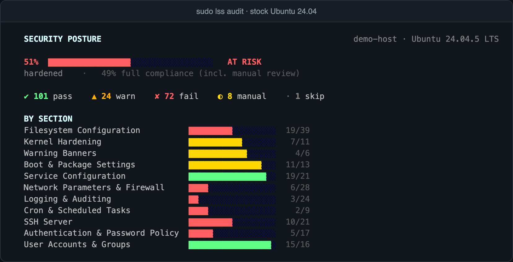</td>
<td width="50%">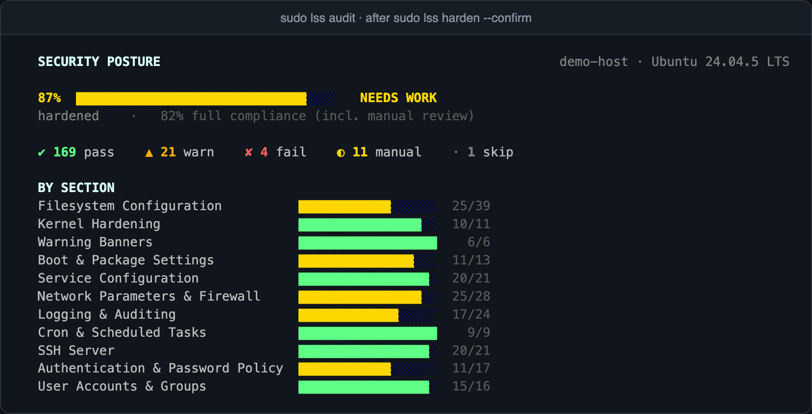</td>
</tr>
</table>

Failing controls dropped from 72 to 4 and stayed there after the reboot.

**Implementation**

- **Rollback journal:** each run gets an ID, and each change records its control, a backup of the modified file and an argv-list undo command. Journal writes are atomic (temp file, fsync, rename).
- **Rollback:** `lss rollback` replays entries in reverse by `--last`, `--run-id` or `--control`, and restores check file mtime first. Undo commands run with `shell=False`, and a regression test confirms that string-form entries are refused.
- **sshd:** settings go in a drop-in validated with `sshd -t`. A failed validation reverts the drop-in before any reload.
- **Lockout guard:** control 5.2.11 is skipped when no non-root sudo or wheel admin with a login shell exists:

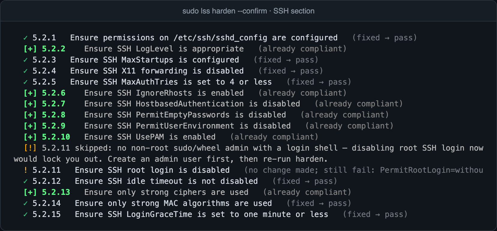

- **sysctl:** values persist in per-key `99-zzzz-` files, which sort after the stock `99-sysctl.conf` so they survive a reboot.
- **Mounts:** rollback remounts with inverse flags (`exec`, `suid`, `dev`), because a remount keeps any flag it doesn't name.
- **Unreadable evidence:** a check that can't read its source returns a warning, such as `cannot verify cramfs: loaded modules unreadable`.
- **Reporting:** JSON audit logs (`root:root`, `0640`), HTML reports and before/after deltas with `lss report --baseline`.

**Rollback result:** the run above rolled back with no errors, even after the reboot. `sshd_config`, `sysctl.conf`, `fstab` and `login.defs` came back byte-identical. One runtime kernel setting can't be reverted live and returns to its default at the next boot, which LSS reports.

---

## LSS STIG

**Audit, remediation and rollback for the Canonical Ubuntu 24.04 LTS STIG V1R6, with a `.cklb` checklist from every audit.**

Covers all 194 rules (16 CAT I, 161 CAT II, 17 CAT III). The rule catalog is imported from DISA's XCCDF, so IDs, severities and check and fix text match the published STIG. It runs on the Python standard library alone, ships as a `.deb` or a single `.pyz` for air-gapped hosts, and verifies Ed25519-signed licenses offline.

Stock Ubuntu 24.04 before hardening, and after hardening and a reboot:

<table>
<tr>
<td width="50%">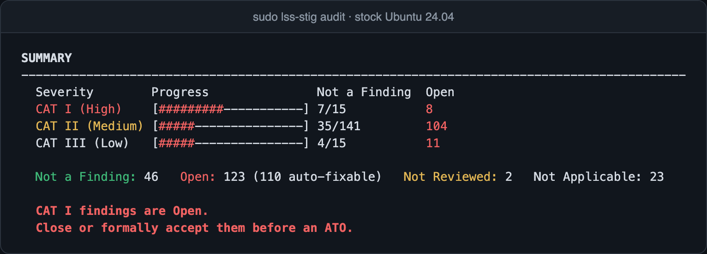</td>
<td width="50%">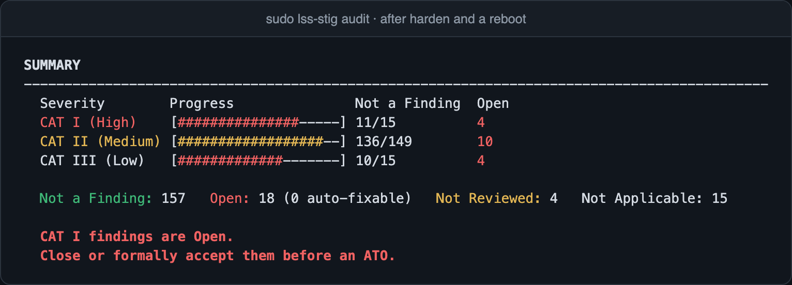</td>
</tr>
</table>

One run applied 102 fixes with no errors, reducing open findings from 123 to 18 through a reboot. The remaining 18 need site decisions, such as FIPS mode, a GRUB password and PKI. After rollback, audit results, packages, services, firewall state and SSH settings matched the original host.

**Implementation**

- **Audit rules:** required rules are compared semantically against `auditctl -l`, with its rewritten output normalized. A rule on disk that isn't loaded is a finding.
- **sshd:** checks both `sshd -T` and every `sshd_config*` file. Conflicting lines are backed up and commented out, and if `sshd -t` fails, every file is reverted.
- **dconf:** detects keyfiles written without `dconf update` and profiles that don't read `system-db:local`.
- **Checklists:** STIG Viewer 3 `.cklb` output with the evidence for each automated check in Finding Details. `audit` exits `1` when any finding is open.

**Fix text corrections.** Where a published fix would damage the host or fail its own check, LSS STIG implements what the rule's check verifies:

| Rule | Published fix | Failure mode | LSS STIG |
|---|---|---|---|
| V-270824 | `chmod -R 755` on command directories | Strips setuid from `sudo`, `su` and `passwd` | Removes only directory write bits |
| V-270655 | `ufw enable` | Locks out remote admins | Applies `ufw limit` to SSH ports first |
| V-270645 | Purge `systemd-timesyncd` | Leaves no time daemon | Installs chrony first |
| V-270694 | `while true` loop around `read` for the consent prompt | Any login shell with no terminal spins at 100% CPU | Refuses that session |
| V-270690 | Add faillock lines below `pam_unix` | Shifts `success=N` jumps, so with `pam_sss` a valid login lands on `pam_deny` | Recomputes jumps and keeps the tally in `/var/lib/faillock` |
| V-270757, V-270762 | `0640` on journal directories | Clears setgid, so rotated files become `root:root` | Also sets `Group=systemd-journal` for journald |
| V-270658, V-270819 | `systemctl restart auditd` | Ubuntu refuses the restart | Reloads auditd with SIGHUP |
| V-270758 | `chmod 740 journalctl` | Reverted by the next systemd update | Holds the mode with `dpkg-statoverride` |

---

## Wraith

**Manifold-based command-and-control detection through involuntary OS telemetry, with blind dual-layer validation.**

Wraith is the reference implementation of my paper: [*The Wraith: Manifold-Based Command-and-Control Detection Through Involuntary Operating System Telemetry with Blind Dual-Layer Validation*](https://doi.org/10.5281/zenodo.19561081).

Encryption, domain fronting and sleep obfuscation change how an implant's traffic looks, but the implant still has to create threads, allocate memory and open sockets. Wraith samples those effects as a 12-dimensional state vector at 1 Hz and scores each window against a learned manifold of normal host behavior, independent of the C2 framework or transport.

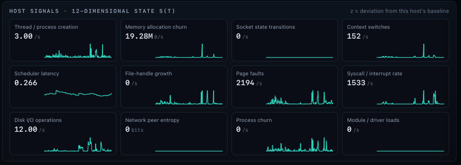

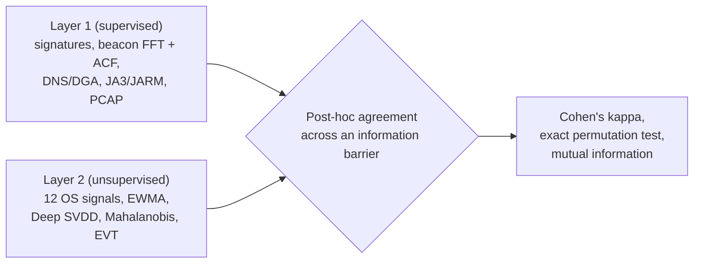

| Component | Implementation |
|---|---|
| Telemetry | eBPF (bcc) tracepoints or procfs counters on Linux, psutil deltas on macOS and Windows |
| Detection model | Deep SVDD in pure NumPy, with Mahalanobis distance in latent space |
| Thresholding | EVT Peaks-Over-Threshold, calibrated on a held-out split to a target false-positive rate |
| Fast path | Per-event eBPF ring buffer with sub-second, event-driven scoring |
| Validation | Sealed logs enforce the information barrier, and significance comes from an exact circular-shift permutation test |
| Response | Honeytokens, decoys, DNS sinkhole, and CASE/UCO evidence with chain of custody |

**Blind validation.** The layers share no data until both finish. Across 1,200 windows they reached Cohen's kappa +0.992 (p = 8.33e-04, 0.955 bits of mutual information). Layer 2 also flagged a C2 framework withheld from Layer 1.

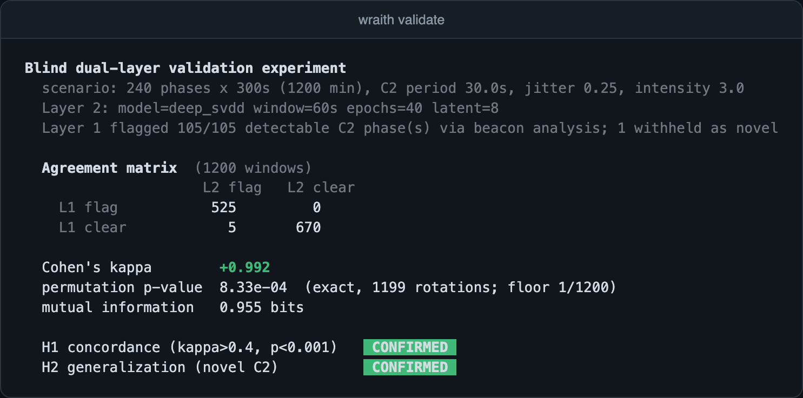

**Time to detect.** Against 150 ms hands-on-keyboard command bursts, the fast path detected 8 of 8 sessions at a 110 ms median and 126 ms p95, with 0.00 false positives per host-hour. The 1 Hz window path detected none of them.

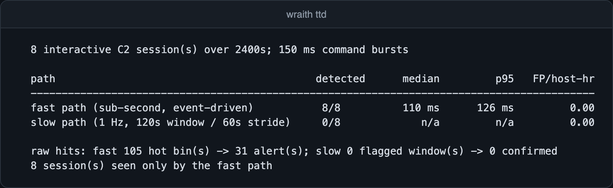

**SOC console.** Live manifold distance, per-signal deviation and an alert queue. Shown here on macOS, learning a host baseline from live telemetry (hostname redacted):

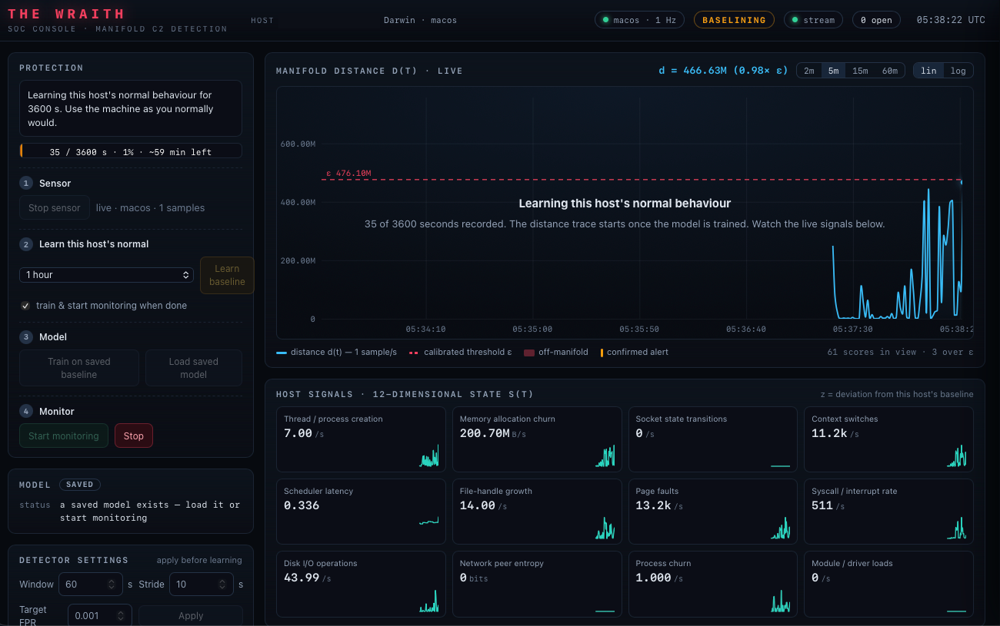

> **Validation status:** the kappa and time-to-detect results were measured on Wraith's synthetic workloads. Validation against real captures and live implants is the next stage of the project.

---

## SitRep

SitRep runs on Linux and macOS. It reads tens of thousands of log lines in seconds and reports back with descriptions in easy-to-read language, along with remediation for some errors. A 50,000-line test log took 0.12 seconds.

Logs are matched against about 50 built-in failure patterns and ranked by severity. This run used a sample log with disk and memory failures:

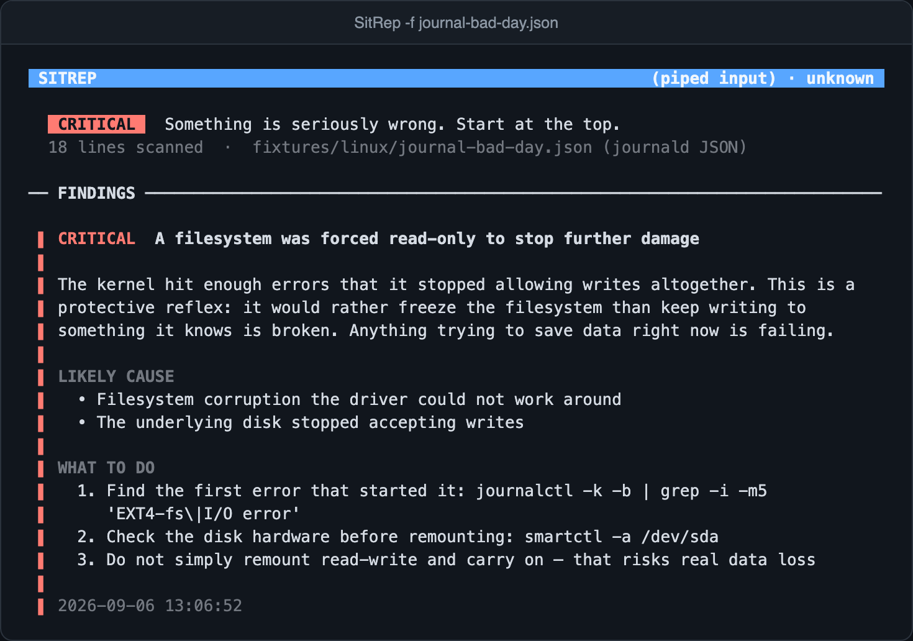

- **No network code:** CI fails the build if any is added.
- **Distribution:** statically linked Linux builds and a universal macOS binary.
- **Pattern learning:** unrecognized lines are grouped, and SitRep drafts rules for them.
- **Automation:** JSON output and exit codes for cron and CI, plus piped logs from remote servers.

---

## APEX

**Classifies a shell script by purpose and raises it to the standard for that domain.**

| Script domain | Target standard |
|---|---|
| CIS hardening | DISA STIG practices |
| Forensic acquisition | Chain of custody, dual hashing and verification, write-blocking |
| OS installation | Unattended or interactive installs with preflight checks and destroy guards |
| General | Strict mode, error traps, logging, locking and proper command-line options |

The engine is deterministic, offline and free of third-party dependencies. Transforms are idempotent, add only what a script lacks and are checked before the file is written. Here it upgrades a sample forensic script (trace shortened):

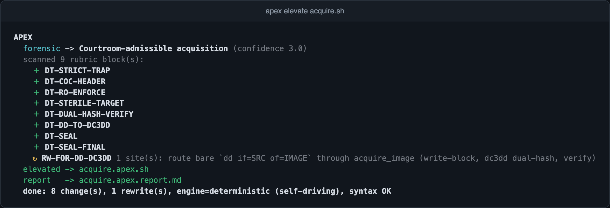

---

## Canon

**Whole-manuscript continuity analysis on Claude Opus 4.8 and its 1M-token context window.**

Canon extracts a story bible of characters, locations, timeline and world facts. It then sends the full manuscript and bible in a single cached call and reports continuity breaks with severity and confidence scores. Customers bring their own Anthropic key, and license checks run server-side and fail closed in production.

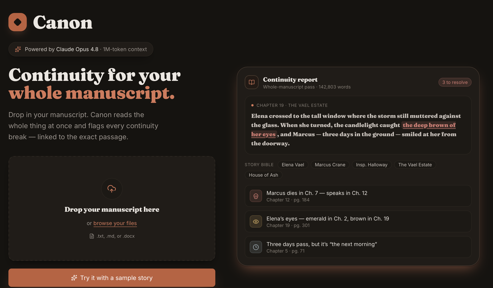

Home page, with an illustrative continuity report.

> **Validation status:** manuscript upload and parsing are tested, and the bundled 5-chapter sample runs the full workflow in demo mode with prepared analysis. Live Claude validation is pending.

---

## Cull

**Burst clustering and keeper selection for photos, with analysis running in the browser.**

Cull computes aHash and dHash perceptual hashes and a Laplacian-variance sharpness score on the client, then clusters bursts by Hamming distance. An optional step sends one 256px thumbnail per photo to Claude to choose each burst's keeper, and falls back to the sharpest frame if Claude is unavailable. Full-resolution files stay in the browser, and keepers export as a zip.

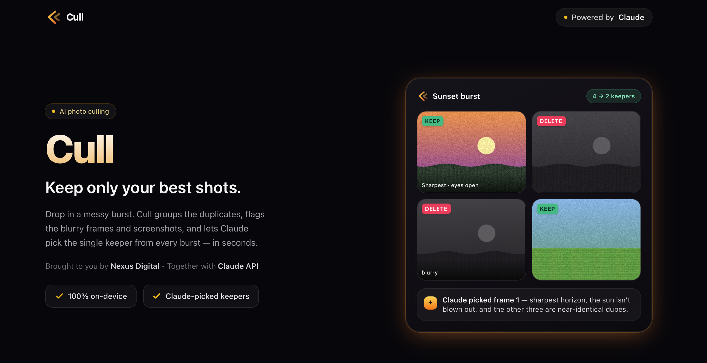

Home page, with an illustrative burst. The "100% on-device" label applies to the local steps, since the optional Claude step sends thumbnails.

> **Validation status:** in a run on 15 synthetic images, Cull sorted all 12 burst frames into the correct 3 bursts and exported 5 keepers. Screenshot detection needs more tuning, and live Claude validation is pending.

---

## ReplyDesk

**Voice-profile reply drafting for customer reviews, email and DMs, running in the browser on the customer's own Anthropic key.**

An interview builds a voice profile for the business. An inbox then drafts each reply in that voice, with tone controls and a refund-policy guard.

Promotional artwork.

> **Validation status:** prototype. The interface runs end to end on a scripted interview and a sample inbox, and importing real reviews isn't connected yet. Live Claude validation is pending.

---

## Testing

LSS and LSS STIG also completed full harden, reboot and rollback cycles on an Ubuntu 24.04 arm64 VM. Test suites as last run: LSS, LSS STIG, Wraith and APEX on Ubuntu 24.04 arm64, and SitRep, Canon and Cull on macOS. The Canon and Cull suites cover license validation.

| Project | Result |
|---|---|
| LSS | 1,709 passed, 1 skipped |
| LSS STIG | 91 tests passed |
| Wraith | 675 passed, 4 skipped |
| SitRep | 79 passed |
| APEX | 101 checks passed |
| Canon | 10 passed |
| Cull | 10 passed |

---

## Contact

For a demo or licensing: **jakep8888@proton.me**

Copyright © 2026 Jacob Douglas Parmenter. All rights reserved. See [LICENSE](LICENSE).
